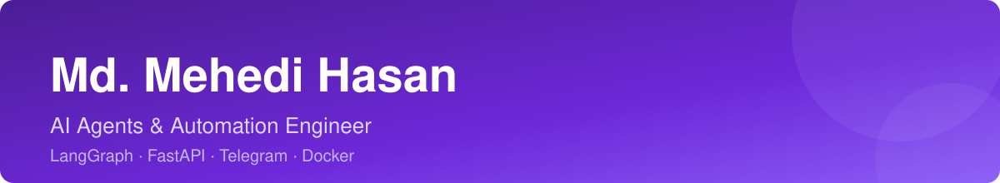
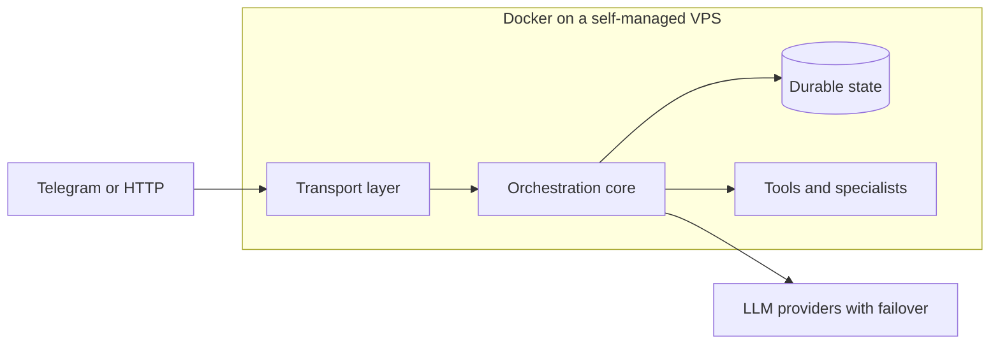

  

  
  
  
  

## Hi, I'm Mehedi. I build AI agents and automations that run on real infrastructure.

I'm a BSc engineering student from Bangladesh who builds agentic systems end to end: stateful LangGraph agents, FastAPI services and Telegram interfaces, packaged with Docker and checked in CI. I care about the parts that decide whether an agent still works after the demo: durable memory, provider failures, configuration and deployment.

- **Role:** AI Agents & Automation Engineer, BSc Engineering student
- **Location:** Bangladesh (UTC+6), available for remote work across time zones
- **Portfolio:** [mdmehedihasan.net](https://mdmehedihasan.net/)

## Currently

- **Building:** Sara, a LangGraph companion with voice and long-term memory, and an evidence-driven research platform

## Open to

- **Internships and junior roles** in AI or automation engineering
- **Freelance projects:** AI agents, Telegram bots and workflow automation

Best way to reach me: **hello@mdmehedihasan.net**

## Featured projects

**[Sara: stateful Telegram companion](https://github.com/mehedibuilds/sara-companion-agent)**  
A companion built as an explicit LangGraph orchestration graph (perception, companion, synthesis). It handles text and voice, keeps auditable long-term memory in SQLite with full-text search, and delegates work to a pluggable specialist registry.  
`Python` `LangGraph` `SQLite FTS5` `Telegram` `Docker`

**[Nova: configuration-first companion runtime](https://github.com/mehedibuilds/nova-companion-agent)**  
A self-hosted runtime where persona, allowed users and model failover order are declarative config. It tries Ollama, Gemini, Groq, NVIDIA NIM and OpenRouter in priority order and fails over only on retryable provider errors. Served over HTTP and Telegram.  
`Python` `FastAPI` `Telegram` `Docker`

**[AI Research Intelligence: evidence-driven research platform](https://github.com/mehedibuilds/ai-research-intelligence)**  
A job-based research system that separates planning from execution: a job needs an explicit plan and a policy check before it runs, and factual output is stored as claims with source evidence. FastAPI backend, pluggable research engines and a Next.js dashboard.  
`Python` `FastAPI` `SQLAlchemy` `Next.js` `Docker`

**[YouTube Shorts Autonomous Agent](https://github.com/mehedibuilds/YouTube-Shorts-Autonomous-Agent)**  
A Telegram-controlled studio for a Shorts channel. Gemini generates stories and scene-by-scene visual prompts, a memory tracker avoids repeating past ideas, and uploaded videos get SEO metadata and a scheduled release through the YouTube Data API.  
`Python` `Gemini API` `YouTube Data API` `Telegram`

> **Sara vs. Nova:** Sara is about orchestration and memory, a stateful graph that remembers people. Nova is about runtime reliability, a config-driven service that keeps answering when a model provider fails.

Sara, Nova and the research platform each ship with Docker support, tests and a ruff + pytest GitHub Actions check.

More on my [repositories tab](https://github.com/mehedibuilds?tab=repositories).

## How I structure agents

The same pattern runs through my projects: a thin transport layer (Telegram or HTTP), an orchestration core (a graph or a runtime), durable state, and LLM providers behind an interface so they can be swapped or failed over. Everything is containerised and runs on a VPS I manage.

## Tech stack

| Area | Tools |
|---|---|
| Agents & LLMs | Python, LangGraph, Gemini API, multi-provider LLM failover, speech-to-text and text-to-speech |
| Backend & data | FastAPI, Pydantic, SQLAlchemy, SQLite (FTS5) |
| Interfaces | Telegram Bot API, YouTube Data API, Next.js |
| Quality & infra | Docker, GitHub Actions (ruff + pytest), Linux, self-managed VPS |
| Also comfortable with | TypeScript, React, Node.js, MongoDB |

<!--
Maintenance notes (not rendered):
- Add one real result per project only when you have a true number, e.g. users, jobs run, uptime.
- Add demo links per project once they exist.
- Add a "Learning" line under Currently only if it is true and current; refresh monthly.
- Re-add n8n, RAG, PostgreSQL or Redis to the stack only once a public repo demonstrates them.
-->
